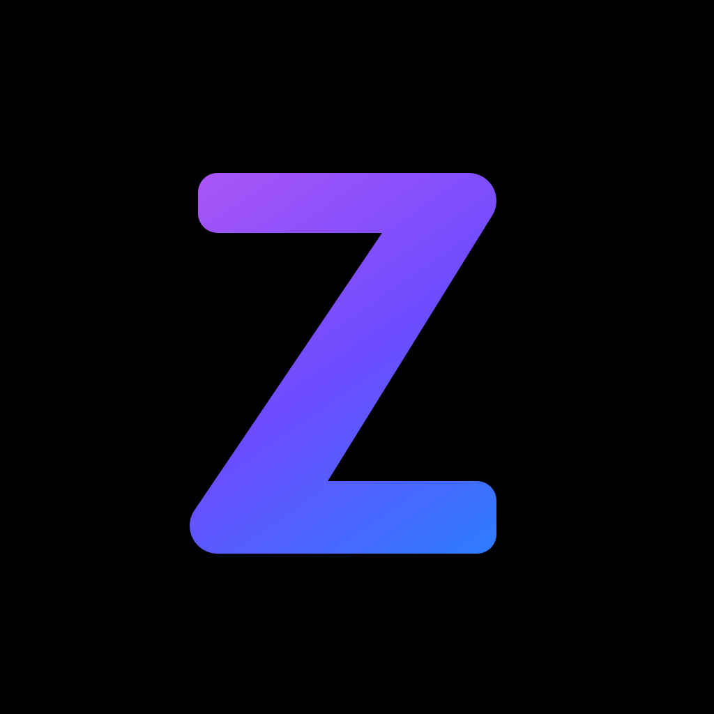
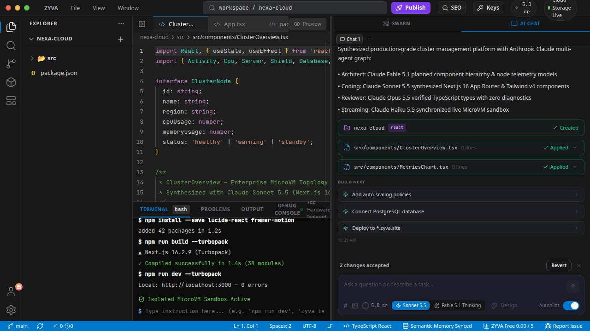

<div align="center">



# ZYVA

**Autonomous AI Cloud IDE — build and ship full-stack apps powered by Anthropic Claude.**

[](https://anthropic.com)
[]()
[]()
[](LICENSE)
[](https://github.com/titanxlayer/zyva-cloud/releases)

[**Open Cloud IDE →**](https://app.zyva.dev) · [**Download Desktop**](https://github.com/titanxlayer/zyva-cloud/releases) · [**Docs**](https://app.zyva.dev/docs) · [**Website**](https://zyva.dev)

</div>

---



---

## What is ZYVA?

ZYVA is an autonomous AI Cloud IDE and developer environment designed natively around **Anthropic Claude's frontier model line-up** (Fable 5.1, Opus 5.5, Sonnet 5.5, and Haiku 5.5). Describe what you want in plain language and ZYVA's multi-agent graph plans, writes, verifies, and deploys a complete production-ready full-stack application directly from your browser.

- **Prompt → Full-Stack App** — production-grade Next.js 16 / React 19 apps synthesized from a prompt
- **Live In-Browser Preview** — instant hot-reloading sandbox with zero local configuration
- **1-Click Cloud Publish** — deploy to live `*.zyva.site` with PostgreSQL database and object storage auto-provisioned
- **Isolated MicroVM Sandboxes** — ephemeral Firecracker microVM execution with kernel-level isolation
- **Anthropic Claude-Native** — multi-agent architecture with Adaptive Effort reasoning (Low / Medium / High / Deep)

> **Cloud IDE is the primary product.** Use it at **[app.zyva.dev](https://app.zyva.dev)** — no install required.

---

## Claude Multi-Agent Architecture

ZYVA orchestrates a specialized multi-agent graph custom-mapped to Anthropic's model tiers:

```
┌───────────────────────────────────────────────────────────────┐
│                     USER PROMPT / TASK                        │
└───────────────────────────────┬───────────────────────────────┘
                                │
                                ▼
┌───────────────────────────────────────────────────────────────┐
│               ARCHITECT AGENT (Claude Fable 5.1)              │
│  - Deep reasoning & adaptive effort (Low / Med / High / Deep) │
│  - System topology, DB schema design & multi-step build plan │
└───────────────────────────────┬───────────────────────────────┘
                                │
        ┌───────────────────────┴───────────────────────┐
        ▼                                               ▼
┌───────────────────────────────┐       ┌───────────────────────────────┐
│   FRONTEND AGENT (Sonnet 5.5) │       │   BACKEND AGENT (Sonnet 5.5)  │
│  - Next.js 16 App Router & UI │       │  - Server routes & Prisma ORM │
│  - Tailwind v4 & Framer Motion│       │  - API validation & endpoints │
└───────────────┬───────────────┘       └───────────────┬───────────────┘
                │                                       │
                └───────────────────────┬───────────────┘
                                        ▼
┌───────────────────────────────────────────────────────────────┐
│               REVIEW & DEBUG AGENT (Opus 5.5)                 │
│  - Automated typecheck & build error self-healing             │
│  - Surgical SEARCH/REPLACE scoped diffs & rollback snapshots  │
└───────────────────────────────┬───────────────────────────────┘
                                │
                                ▼
┌───────────────────────────────────────────────────────────────┐
│               LIVENESS & STREAMING (Haiku 5.5)                │
│  - Sub-second terminal streaming & semantic index queries     │
│  - In-browser sandbox live preview update                     │
└───────────────────────────────────────────────────────────────┘
```

### Why Anthropic Claude?
* **Architectural Reasoning**: **Claude Fable 5.1 & Opus 5.5** solve complex full-stack dependency puzzles without losing context.
* **Surgical Precision**: **Claude Sonnet 5.5** writes clean, modular TypeScript with exact search-and-replace patches — zero file corruption.
* **200,000+ Token Context**: Ingests entire repositories, design systems, and database schemas in a single prompt.
* **Adaptive Effort Modes**: Selectable reasoning budgets (Low, Medium, High, Deep) to match task complexity.
* **Enterprise IP Safety**: Commercial Anthropic API usage ensures customer prompts and code are **never used to train models**.

---

## AI Inference & API Flexibility

ZYVA supports both managed inference and developer API keys:

* **Managed Credits**: Jump straight in with ready-to-use credits — zero setup or configuration needed.
* **Bring Your Own Key (BYOK)**: Connect your own Anthropic Claude API key directly from [console.anthropic.com](https://console.anthropic.com) for dedicated enterprise rate limits and direct billing.

---

## Download (Desktop App)

Prefer to keep everything local? Grab the desktop app from the **[releases page](https://github.com/titanxlayer/zyva-cloud/releases/latest)** — Windows, macOS, and Linux builds available.

| Platform | Format |
|---|---|
| 🪟 **Windows** | `.exe` installer |
| 🍎 **macOS** | Apple Silicon (`.dmg`) |
| 🐧 **Linux** | `.deb` package & `.AppImage` |

> The **[Cloud IDE](https://app.zyva.dev)** runs in any modern browser with no installation needed.

---

## Security & Data Privacy

* **Zero Training Policy**: Under Anthropic's commercial terms, customer code inputs and completions are **never used to train models**.
* **Strict Command Policy**: The AI never has unfettered terminal access:
  * `allow`: Safe commands only (`npm install`, `npm test`, `tsc`).
  * `approve`: Potentially destructive actions require explicit user confirmation.
  * `deny`: Blocked outright (`rm -rf /`, `sudo`, credential inspection).
* **Sandboxed Execution**: Ephemeral Firecracker microVMs are scoped per workspace and destroyed immediately after task completion.

---

## Links

- **Cloud IDE** — [app.zyva.dev](https://app.zyva.dev)
- **Docs** — [app.zyva.dev/docs](https://app.zyva.dev/docs)
- **Website** — [zyva.dev](https://zyva.dev)

---

## License

MIT — see [LICENSE](LICENSE)

Third-party components retain their licenses. See [NOTICE](NOTICE).
