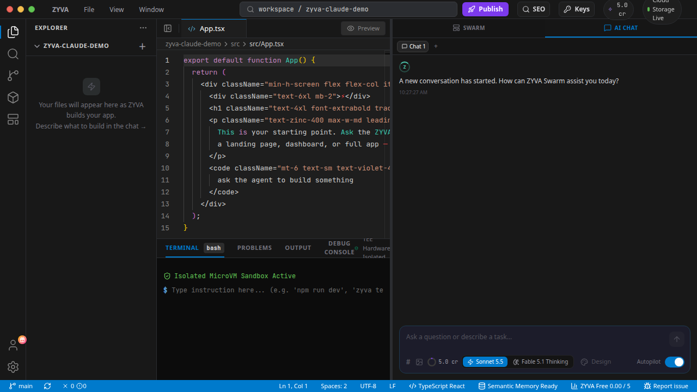

# ZYVA

**AI-powered Cloud IDE — build and ship apps from your browser.**

[**Try Cloud IDE →**](https://app.zyva.dev) · [**Docs**](https://app.zyva.dev/docs) · [**zyva.dev**](https://zyva.dev)

---

---

## What is ZYVA?

ZYVA is a Lovable-style AI coding environment. Describe what you want in plain language and ZYVA plans, writes, builds, and ships a working app — straight from your browser.

- **Prompt -> app** — full-stack React + Vite + Tailwind apps from a single prompt
- **Live preview** — see changes as they're generated, no setup
- **1-click publish** — ship to a live URL with database and storage included
- **Isolated execution** — each session runs inside a Firecracker microVM
- **TEE-attested inference** — every model call runs inside a Trusted Execution Environment

> **Cloud IDE is the primary product.** Use it at **[app.zyva.dev](https://app.zyva.dev)** — no install required.

---

## AI Inference — 0G Private Computer

All inference runs on **[0G Private Computer](https://pc.0g.ai)** — an OpenAI-compatible API where every request is processed inside a TEE (Trusted Execution Environment).

- **Private by design** — prompts and code are processed inside a TEE, isolated from the host
- **Frontier-class LLM** — tuned for long-context, agentic coding (1M-token context)
- **Zero config** — no model picker, no bring-your-own-key; ZYVA manages inference for you, and upgrades the model over time as stronger ones land

---

## Download (Desktop App)

Prefer to keep everything local? Grab the desktop app from the **[releases page](https://github.com/titanxlayer/zyva-cloud/releases/latest)** — Windows, macOS, and Linux builds. The Cloud IDE at [app.zyva.dev](https://app.zyva.dev) needs no install.

> Preview builds are unsigned, so your OS may warn on first launch.

---

## Security Model

- The model **never** executes shell directly — all commands pass through a policy layer (allow / approve / deny)
- Per-user workspace isolation, validated server-side
- Firecracker microVMs scoped per session, torn down after each task
- TEE attestation recorded for every inference request

---

## Links

- **Cloud IDE** — [app.zyva.dev](https://app.zyva.dev)
- **Docs** — [app.zyva.dev/docs](https://app.zyva.dev/docs)
- **Website** — [zyva.dev](https://zyva.dev)

---

## License

MIT — see [LICENSE](LICENSE)

Third-party components retain their licenses. See [NOTICE](NOTICE).
